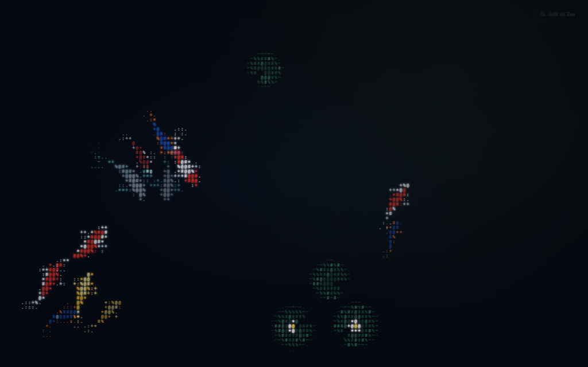
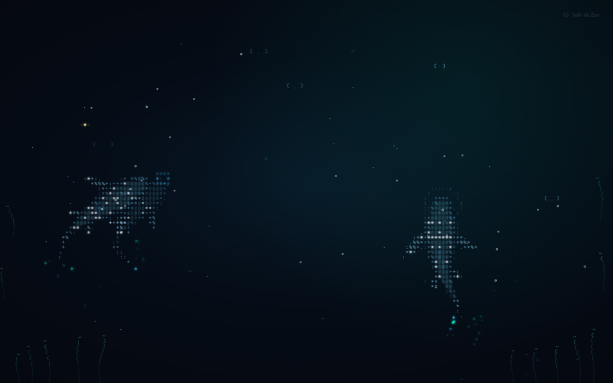
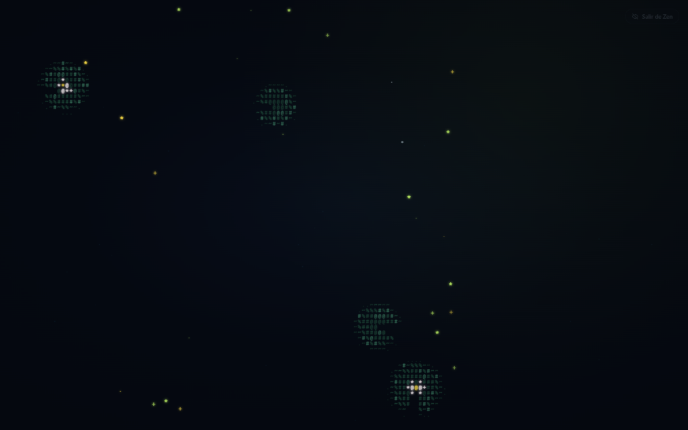

# ASCII Koi Pond New Tab

Extensión **Manifest V3** interactiva, multilingüe (`es` / `en`) y sin dependencias externas que reemplaza la página de Nueva Pestaña por un estanque zen luminoso en arte ASCII. Construida con módulos ES nativos, HTML5 Canvas, un atlas de glifos pre-renderizados (`OffscreenCanvas`), Object Pooling sin asignaciones en bucle y herramientas de productividad diaria.

**[Descargar última versión (Release)](https://github.com/DAHL13/ACSII-KOI/releases/latest)** · **[Política de Privacidad](PRIVACY.md)**

---

## Vista Previa

### Peces Koi


### Tortugas Marinas


### Tiburón Ballena


### Tiburón Martillo


### Luciérnagas


### Interfaz, Modo Día, Lluvia Suave, Pétalos de Cerezo (`🌸`) y Comandos Bangs


---

## Características

- **Selector de Fauna y Especies Articuladas (`GlyphAtlas`):**
  - **Peces Koi:** Columna vertebral articulada de 12 nodos, genética ponderada (*Kohaku*, *Yamabuki Ogon*, *Showa*, *Asagi*, más variantes raras *Tancho* 8% y *Butterfly Fantasma* 7%).
  - **Tortugas Marinas:** Caparazón con placas doradas, aleteo lento de remado y nado sereno.
  - **Tiburón Ballena y Tiburón Martillo:** Siluetas cenitales realistas con propulsión carangiforme fluida en la cola, aletas pectorales falcadas, aletas pélvicas, cefalofoil curvo en `"T"` (Martillo) y patrón moteado luminoso (Ballena).
  - **Luciérnagas:** Controlables en modo `Auto` (noche), `Activas` (a cualquier hora) u `Off`.
  - Atlas de glifos pre-renderizados en `OffscreenCanvas` ([`src/render/glyph-atlas.js`](src/render/glyph-atlas.js)) con doble estado (`glow` y `flat`), eliminando por completo `fillText()` y `shadowBlur` del bucle principal de animación.
- **Hábitat `Estanque` vs `Mar Abierto`:**
  - **Estanque:** Nenúfares ASCII con muesca en `"V"`, flores de loto, deriva suave, colisiones elásticas y oclusión 2.5D (*broad-phase* + *narrow-phase* al `22%` de opacidad sin brillo).
  - **Mar Abierto:** Corrientes marinas (`≈`, `~`, `·`), rayos de luz submarinos, algas ondulantes en los márgenes, 3 medusas abisales pulsantes, plancton bioluminiscente al mover el cursor o girar, burbujas ascendentes y un **cardumen de 45 micro-peces** que se dispersa en remolino ante los tiburones y el cursor.
  - Cada capa ambiental puede activarse o combinarse individualmente desde el panel de Fauna y Entorno.
- **Ciclo Solar y Clima Dinámico:**
  - Fases solares automáticas o manuales (`Auto`, `Día`, `Tarde`, `Noche`) con cáusticas sutiles de día y reflejos cálidos al atardecer.
  - Interruptor de lluvia suave (`|`, `/`, `'`) que genera micro-ondas azules `( )` → `(   )` al impactar en el agua.
- **Accesos Directos "Piedras de Río":**
  - Fila inferior de cantos rodados oscuros poblados automáticamente con `chrome.topSites` (con enlaces predeterminados de respaldo), carga de favicons mediante la API nativa `/_favicon/` con respaldo circular por inicial del dominio, ondas de agua al pasar el cursor y edición/alta/eliminación persistida en `localStorage`.
- **Buscador Inteligente (Bangs, URLs directas y búsqueda nativa):**
  - Usa `chrome.search.query()` para respetar el motor de búsqueda predeterminado del navegador (con respaldo automático a Google si no está disponible).
  - Transformación en tiempo real de prefijos Bang en píldoras coloreadas y navegación directa de URLs (`localhost:3000`, `github.com`, `https://...`).
- **Temporizador Pomodoro y Lluvia de Pétalos de Cerezo:**
  - Widget colapsable con anillo circular SVG (*Enfoque 25:00* / *Descanso 05:00*) y botón de previsualización `🌸`.
  - Al completar una sesión de enfoque, activa una lluvia de pétalos de cerezo (`✿`, `❀`, `*`, `~`, `·`) durante 25 segundos usando un Object Pool de 90 pétalos que generan ondas al aterrizar y atraen la curiosidad de los Koi cercanos.
- **Rendimiento y Modo Zen:**
  - Pausa inteligente en segundo plano con Page Visibility API (`visibilitychange`), `deltaTime` acotado (`<= 0.05s`), pools de objetos reutilizables, indicador opcional de FPS/`ms` en tiempo real y **Modo Zen** (`Z` / `Esc`).

---

## Comandos Rápidos de Búsqueda (Bangs)

Escribe un prefijo seguido de un espacio al inicio de la barra de búsqueda para convertirlo en una etiqueta visual. Pulsa `Backspace` con el campo vacío para quitarlo.

| Prefijo | Plataforma | Destino |
| :--- | :--- | :--- |
| `!gh ` | GitHub | `https://github.com/search?q=` |
| `!yt ` | YouTube | `https://www.youtube.com/results?search_query=` |
| `!r ` | Reddit | `https://www.reddit.com/search/?q=` |
| `!mdn ` | MDN Web Docs | `https://developer.mozilla.org/{es\|en-US}/search?q=` |
| `!so ` | StackOverflow | `https://stackoverflow.com/search?q=` |
| `!w ` | Wikipedia | `https://{es\|en}.wikipedia.org/w/index.php?search=` |

---

## Instalación

### Microsoft Edge
1. Descarga el archivo `.zip` más reciente desde **[Releases](https://github.com/DAHL13/ACSII-KOI/releases/latest)** y descomprímelo en una carpeta permanente.
2. Abre `edge://extensions` en Microsoft Edge.
3. Activa el **Modo de desarrollador** en el panel lateral o esquina superior.
4. Haz clic en **Cargar descomprimida** y selecciona la carpeta extraída que contiene `manifest.json`.
5. Abre una nueva pestaña. Cuando Edge pregunte si deseas mantener el cambio de Nueva Pestaña, pulsa **"Conservar los cambios"**.

### Google Chrome / Brave / Vivaldi
1. Descarga y descomprime el `.zip` más reciente desde **[Releases](https://github.com/DAHL13/ACSII-KOI/releases/latest)**.
2. Abre `chrome://extensions` (o `brave://extensions` / `vivaldi://extensions`).
3. Activa el **Modo de desarrollador** en la esquina superior derecha.
4. Haz clic en **Cargar descomprimida** y selecciona la carpeta extraída.
5. Abre una pestaña nueva para disfrutar del estanque.

---

## Arquitectura Modular y Desarrollo

- `boot.js`: sincronización síncrona inicial de tema (`data-solar`, `data-biome`, `data-zen`) antes del primer pintado.
- `src/core/`: constantes, utilidades matemáticas, `ObjectPool`, internacionalización (`i18n.js`) y persistencia sincronizada entre pestañas (`storage.js`).
- `src/render/`: atlas de glifos en `OffscreenCanvas` (`glyph-atlas.js`).
- `src/ecosystem/`: nenúfares 2.5D (`lilies.js`), clima y pétalos (`weather.js`), capas oceánicas (`ocean.js`) y fachada `PondEcosystem` (`ecosystem.js`).
- `src/simulation/`: criaturas articuladas (`creature.js`, `species/*.js`), `BaitSchool` y `KoiPondEngine` (`engine.js`).
- `src/productivity/`: validación de URLs/bangs (`url-utils.js`), accesos directos (`river-stones.js`), buscador (`smart-search.js`) y Pomodoro (`pomodoro.js`).
- `styles/`: hojas divididas en cascada (`tokens.css`, `base.css`, `topbar.css`, `stage.css`, `widgets.css`, `responsive.css`).
- `_locales/{es,en}/messages.json`: traducciones nativas MV3.

### Pruebas y Empaquetado

```bash
# Ejecutar pruebas unitarias y de UI en Microsoft Edge / Chromium headless
python scripts/run-tests.py

# Empaquetar extensión lista para publicar en dist/ascii-koi-pond-v<version>.zip
python scripts/package.py
```

En Windows PowerShell también están disponibles `scripts/run-tests.ps1` y `scripts/package.ps1`.

---

## Privacidad y Licencia

- Lee la [Política de Privacidad](PRIVACY.md): no existe telemetría ni tráfico de red oculto (`connect-src 'none'`).
- Distribuido bajo la licencia [MIT](LICENSE).
