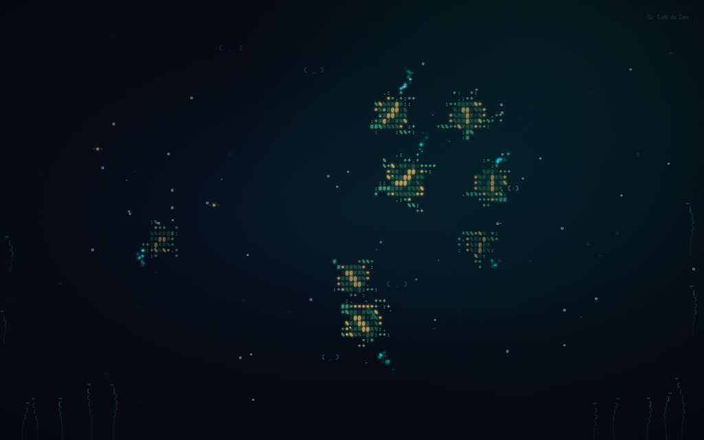
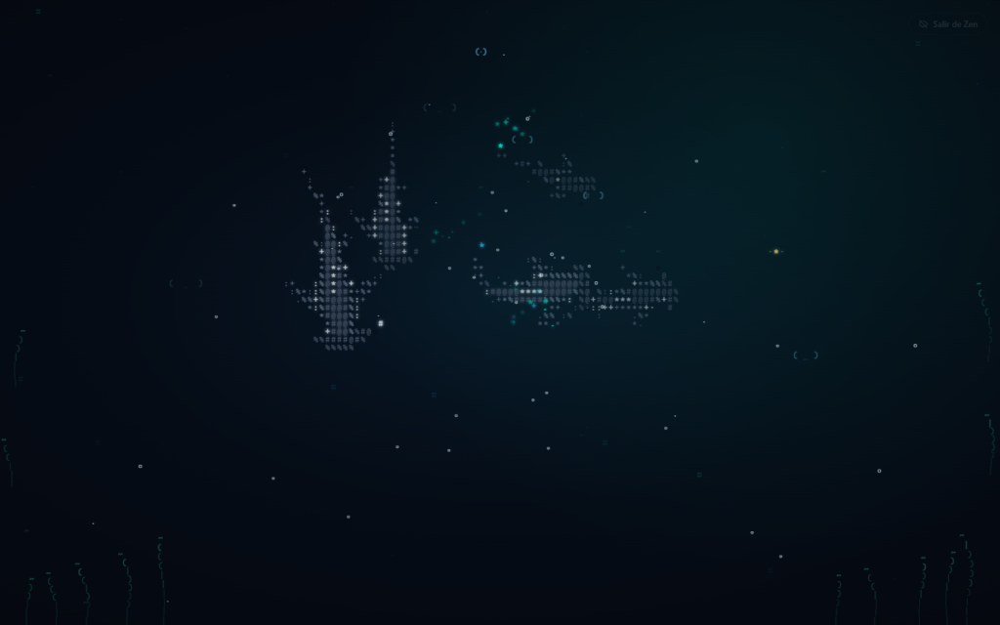
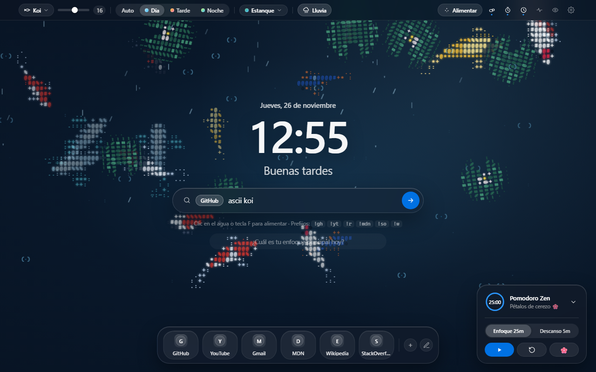
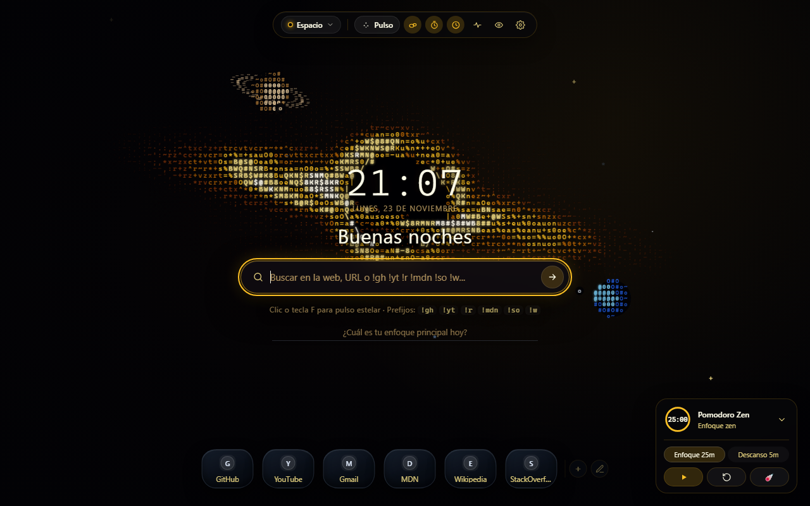
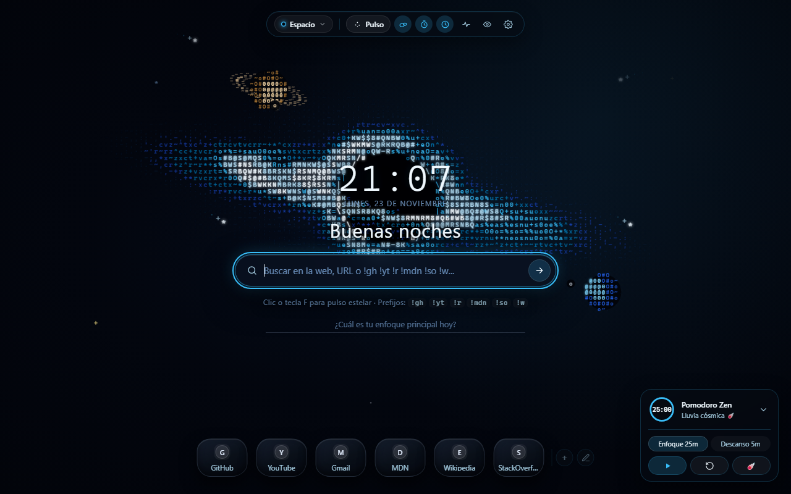
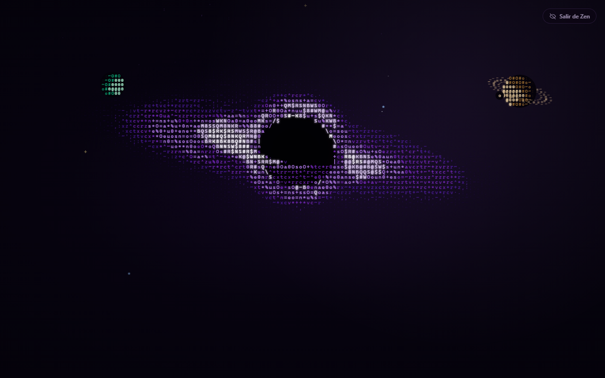
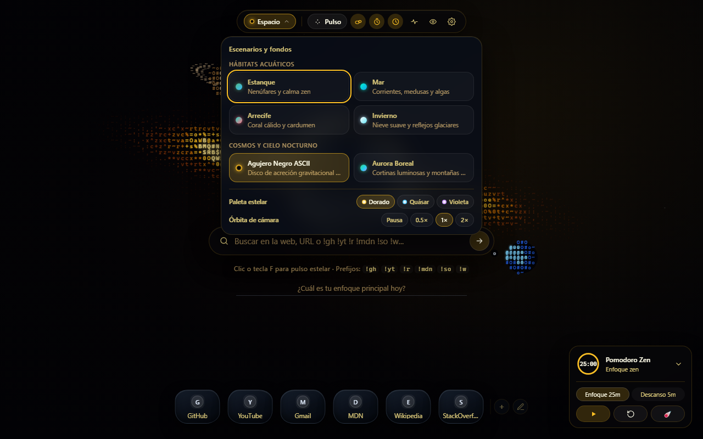
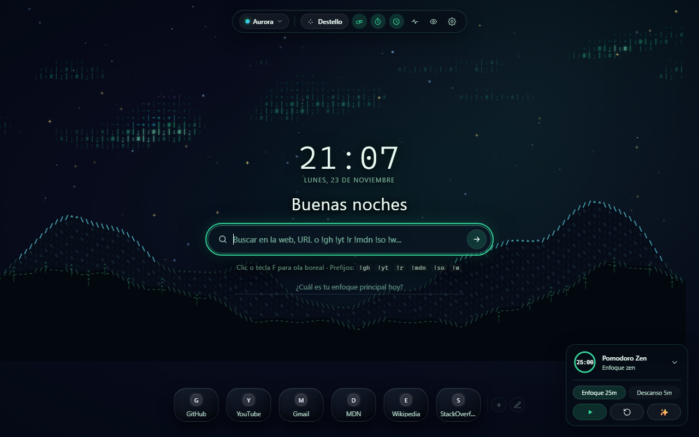

# ASCII Koi Pond New Tab

Extensión **Manifest V3** interactiva, multilingüe (`es` / `en`) y sin dependencias externas que reemplaza la página de Nueva Pestaña por un estanque zen luminoso en arte ASCII. Construida con módulos ES nativos, HTML5 Canvas, un atlas de glifos pre-renderizados (`OffscreenCanvas`), Object Pooling sin asignaciones en bucle y herramientas de productividad diaria.

**[Descargar última versión (Release)](https://github.com/DAHL13/ACSII-KOI/releases/latest)** · **[Política de Privacidad](PRIVACY.md)**

---

## Vista Previa

### Peces Koi


### Tortugas Marinas


### Tiburón Ballena


### Tiburón Martillo


### Luciérnagas


### Interfaz, Modo Día, Lluvia Suave, Pétalos de Cerezo (`🌸`) y Comandos Bangs


### Espacio Profundo: Agujero Negro ASCII (Dorado), Planetas y Lunas


### Paleta Quásar Azul y Lluvia Cósmica Pomodoro (`☄️`)


### Singularidad Violeta en Modo Zen


### Selector de Escenarios, Paletas Estelares y Velocidad Orbital


### Aurora Boreal Nocturna (`✨`)


---

## Características

- **Selector de Escenarios y Fondos (`Estanque`, `Mar`, `Arrecife`, `Invierno`, `Espacio` y `Aurora Boreal`):**
  - **Hábitats acuáticos:**
    - **Estanque:** Nenúfares ASCII con muesca en `"V"`, flores de loto, deriva suave, colisiones elásticas y oclusión 2.5D (*broad-phase* + *narrow-phase* al `22%` de opacidad sin brillo).
    - **Mar Abierto y Arrecife:** Corrientes marinas (`≈`, `~`, `·`), rayos de luz submarinos, algas ondulantes en los márgenes, 3 medusas abisales pulsantes, plancton bioluminiscente, burbujas ascendentes y un **cardumen de 45 micro-peces** acelerado mediante rejilla espacial (`SpatialHashGrid`).
    - **Invierno:** Paleta glaciar con nevada suave en ASCII (`❄`, `*`, `·`).
  - **Cosmos y cielo nocturno (no acuáticos):**
    - **Espacio Profundo (Agujero Negro ASCII):** Disco de acreción gravitacional en espiral kepleriana, anillo de fotones, arco sutil de lente gravitacional (*Einstein ring*), banda tenue de la Vía Láctea, estrellas 3D, **6 planetas únicos con lunas en órbita** y cámara orbital lenta 3D sin interferencia del puntero. Incluye 3 paletas estelares (*Dorado*, *Quásar Azul* y *Violeta*) y control de velocidad/pausa orbital (`Pausa`, `0.5×`, `1×`, `2×`).
    - **Aurora Boreal:** Cortinas electromagnéticas ondulantes en esmeralda, cian, violeta y magenta sobre cordillera alpina con crestas iluminadas, pinos y estrellas fugaces.
  - Alterna al instante entre el escenario cósmico/celeste activo y tu último hábitat acuático pulsando la tecla `B`.
- **Selector de Fauna y Especies Articuladas (`GlyphAtlas`):**
  - **Peces Koi:** Columna vertebral articulada de 12 nodos, genética ponderada (*Kohaku*, *Yamabuki Ogon*, *Showa*, *Asagi*, más variantes raras *Tancho* 8% y *Butterfly Fantasma* 7%).
  - **Tortugas Marinas:** Caparazón con placas doradas, aleteo lento de remado y nado sereno.
  - **Tiburón Ballena, Tiburón Martillo, Mantarraya y Carpa Dorada:** Siluetas cenitales articuladas con propulsión carangiforme, cefalofoil en `"T"` (Martillo), alas ondulantes (Mantarraya) y velo ámbar luminoso (Carpa Dorada).
  - **Luciérnagas:** Controlables en modo `Auto` (noche), `Activas` (a cualquier hora) u `Off`.
  - Atlas de glifos pre-renderizados en `OffscreenCanvas` ([`src/render/glyph-atlas.js`](src/render/glyph-atlas.js)) con doble estado (`glow` y `flat`), eliminando por completo `fillText()` y `shadowBlur` del bucle principal de animación.
  - Cada capa ambiental puede activarse o combinarse individualmente desde el panel de Fauna y Entorno.
- **Ciclo Solar y Clima Dinámico:**
  - Fases solares automáticas o manuales (`Auto`, `Día`, `Tarde`, `Noche`) con cáusticas sutiles de día y reflejos cálidos al atardecer (ocultas automáticamente en los modos no acuáticos).
  - Interruptor de lluvia suave (`|`, `/`, `'`) que genera micro-ondas azules `( )` → `(   )` al impactar en el agua.
- **Accesos Directos "Piedras de Río":**
  - Fila inferior centrada en una línea con cantos rodados oscuros poblados automáticamente con `chrome.topSites` (con enlaces predeterminados de respaldo), favicons locales mediante `/_favicon/` con inicial de respaldo, edición, **reordenamiento por arrastrar y soltar (`drag & drop`) o botones `‹`/`›`**, sincronización con `chrome.storage.sync` y caché local.
- **Buscador Inteligente (Bangs personalizables, autocompletado y URLs directas):**
  - Usa `chrome.search.query()` para respetar el motor de búsqueda predeterminado del navegador (con respaldo automático a Google).
  - Autocompletado interactivo al teclear `!`, bangs personalizados (solo HTTPS, con soporte `{q}`) configurables desde Ajustes y navegación directa de URLs.
- **Reloj 12h/24h, Saludo Personalizado, Objetivo del Día y Atajos Rápidos:**
  - Formato horario `24h` / `12h`, nombre configurable en el saludo, campo minimalista de enfoque diario y atajos globales (`/` buscar, `F` alimentar/pulso, `R` lluvia, `B` alternar fondo, `P` Pomodoro, `Z` Zen).
- **Temporizador Pomodoro Temático (`🌸`, `☄️`, `✨`):**
  - Widget colapsable con anillo circular SVG (*Enfoque 25:00* / *Descanso 05:00*) y botón de previsualización adaptado al escenario.
  - Al completar una sesión de enfoque, activa una lluvia de pétalos de cerezo (`🌸`, durante 25 s en hábitats acuáticos), una **lluvia de meteoros + destello gravitacional (`☄️`)** en Espacio Profundo, o una **tormenta geomagnética boreal (`✨`)** en Aurora Boreal.
- **Modo Ahorro / Calidad Adaptativa, Respaldo JSON y Modo Zen:**
  - Pausa inteligente en segundo plano con Page Visibility API (simulación y reloj), indicador de FPS/`ms`, modo **Eco** (`Auto` con histéresis automática si `frameTimeMs > 24ms`, `Eco` a `30 FPS` sin brillo o `Alto`), sincronización `chrome.storage.sync` + exportar/importar JSON y **Modo Zen** (`Z` / `Esc`).

---

## Comandos Rápidos de Búsqueda (Bangs)

Escribe un prefijo seguido de un espacio al inicio de la barra de búsqueda para convertirlo en una etiqueta visual. Pulsa `Backspace` con el campo vacío para quitarlo.

| Prefijo | Plataforma | Destino |
| :--- | :--- | :--- |
| `!gh ` | GitHub | `https://github.com/search?q=` |
| `!yt ` | YouTube | `https://www.youtube.com/results?search_query=` |
| `!r ` | Reddit | `https://www.reddit.com/search/?q=` |
| `!mdn ` | MDN Web Docs | `https://developer.mozilla.org/{es\|en-US}/search?q=` |
| `!so ` | StackOverflow | `https://stackoverflow.com/search?q=` |
| `!w ` | Wikipedia | `https://{es\|en}.wikipedia.org/w/index.php?search=` |

---

## Instalación

### Microsoft Edge
1. Descarga el archivo `.zip` más reciente desde **[Releases](https://github.com/DAHL13/ACSII-KOI/releases/latest)** y descomprímelo en una carpeta permanente.
2. Abre `edge://extensions` en Microsoft Edge.
3. Activa el **Modo de desarrollador** en el panel lateral o esquina superior.
4. Haz clic en **Cargar descomprimida** y selecciona la carpeta extraída que contiene `manifest.json`.
5. Abre una nueva pestaña. Cuando Edge pregunte si deseas mantener el cambio de Nueva Pestaña, pulsa **"Conservar los cambios"**.

### Google Chrome / Brave / Vivaldi
1. Descarga y descomprime el `.zip` más reciente desde **[Releases](https://github.com/DAHL13/ACSII-KOI/releases/latest)**.
2. Abre `chrome://extensions` (o `brave://extensions` / `vivaldi://extensions`).
3. Activa el **Modo de desarrollador** en la esquina superior derecha.
4. Haz clic en **Cargar descomprimida** y selecciona la carpeta extraída.
5. Abre una pestaña nueva para disfrutar del estanque.

---

## Arquitectura Modular y Desarrollo

- `boot.js`: sincronización síncrona inicial de tema (`data-solar`, `data-biome`, `data-space-palette`, `data-zen`) antes del primer pintado.
- `src/core/`: constantes, utilidades matemáticas, `ObjectPool`, internacionalización (`i18n.js`) y persistencia sincronizada entre pestañas/dispositivos + respaldo JSON (`storage.js`).
- `src/render/`: atlas de glifos en `OffscreenCanvas` (`glyph-atlas.js`).
- `src/ecosystem/`: nenúfares 2.5D (`lilies.js`), lluvia/pétalos/nieve (`weather.js`), capas oceánicas (`ocean.js`), espacio profundo 3D (`space.js`), aurora boreal (`aurora.js`) y fachada `PondEcosystem` (`ecosystem.js`).
- `src/simulation/`: criaturas articuladas (`creature.js`, `species/*.js` incluyendo `manta.js` y `carp.js`), cardumen con `SpatialHashGrid` (`bait-school.js`) y `KoiPondEngine` con modo Eco (`engine.js`).
- `src/productivity/`: validación de URLs/bangs (`url-utils.js`), accesos directos reordenables (`river-stones.js`), buscador con autocompletado (`smart-search.js`) y Pomodoro (`pomodoro.js`).
- `src/ui/`: controladores modulares (`clock-greeting.js`, `zen-mode.js`, `biome-popover.js`, `fauna-popover.js`, `settings-modal.js`).
- `styles/`: hojas divididas en cascada (`tokens.css`, `base.css`, `topbar.css`, `stage.css`, `stones.css`, `pomodoro.css`, `fauna-popover.css`, `settings.css`, `responsive.css`).
- `_locales/{es,en}/messages.json`: traducciones nativas MV3.

### Pruebas y Empaquetado

```bash
# Ejecutar matriz completa (unitarias, UI es/en y viewports 1280x800, 800x600 y 480x800) en Edge / Chromium headless
python scripts/run-tests.py

# Validar paridad i18n y generar paquetes POSIX para Chrome/Edge y Firefox en dist/
python scripts/package.py --check
python scripts/package.py --target all
```

En Windows PowerShell también están disponibles `scripts/run-tests.ps1` y `scripts/package.ps1`.

---

## Privacidad y Licencia

- Lee la [Política de Privacidad](PRIVACY.md): no existe telemetría ni tráfico de red oculto (`connect-src 'none'`).
- Distribuido bajo la licencia [MIT](LICENSE).
